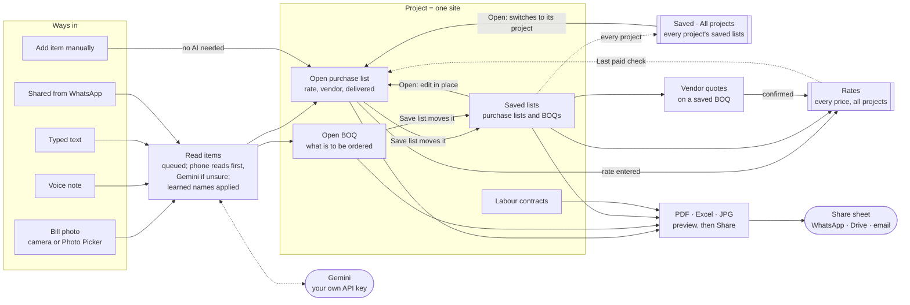
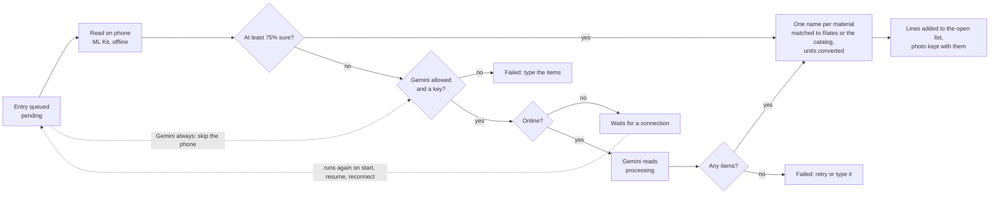
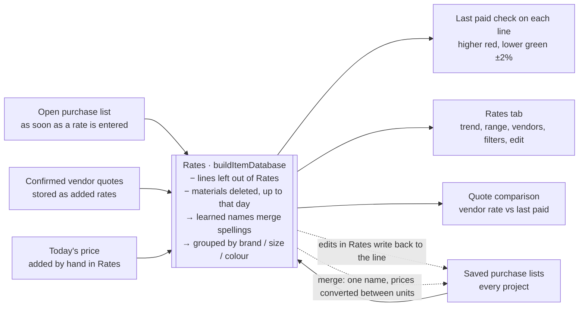
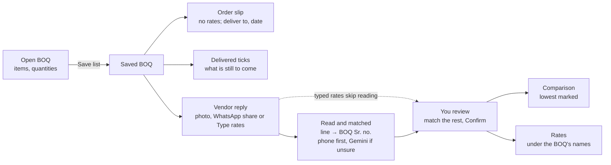
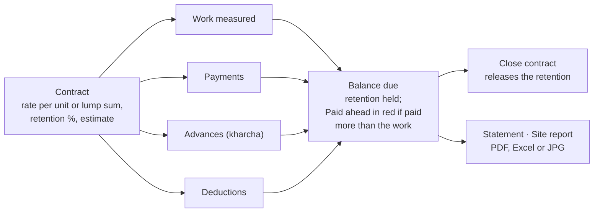
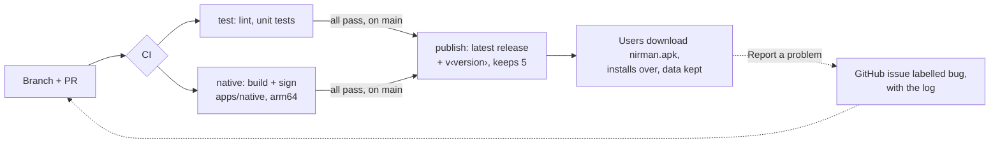

# Nirman workflows

How bills, BOQs, vendor quotes and labour contracts move through the app: what goes in, what the phone does with it, where it is kept and what leaves the phone. Updated for **7.0** from the *Nirman Workflows* diagrams (drawn at 5.0).

**Keep this file current.** When a change alters one of these flows, update the section and its diagram in the same PR. That covers a new way in, a reading step, where prices go, saving, quotes, labour, what leaves the phone, or how an update reaches users. The diagrams are Mermaid, which GitHub draws.

Code these flows come from:
- `packages/core/src/jobs/worker.ts` (reading)
- `packages/core/src/data/repo.ts` (saving, quotes, contracts)
- `packages/shared/src/domain.ts` (Rates, price checks)
- the screens in `apps/native/src/features/`.

## A-01 Overview

Everything lives in one SQLite database on the phone, grouped by project (one site). The only outside service in daily use is Gemini, for bills the phone can't read by itself. Rates spans all projects, and Saved can too (*All projects*, since 7.5).

Saving **moves** the open list into Saved, and an empty one is ready for the next bill (since 6.0). *Open* on a saved list edits that list itself; nothing is copied. The open lists and each saved list (its *Share* button, since 7.4) go out as PDF, Excel or JPG; a BOQ also as an order slip.

*Saved → All projects* (since 7.5) lists the saved lists of every project, newest first, each marked with its project, with search and filters by work type and project. Closed projects' lists show only when *Show closed projects* is ticked. *Open* or *Quotes* on another project's list switches to that project first, so its tabs, quotes and site follow; *Delete all saved lists* is only offered for one project.

Also on the phone:
- **Backup** (`.zip`, by hand): everything, bill photos included, except entries not yet read.
- **Problem log:** *Settings → Report a problem* / *Share log*.
- **Bill photos:** kept with their lines.

## A-02 Reading a bill

Every photo, voice note or text becomes a queued entry. The worker runs on app start, resume, reconnect and after each new entry, one entry at a time. *Settings → How bills are read* picks phone first (default), phone only, or Gemini always.

Notes:
- The 75% threshold is `PHONE_CONFIDENCE` in `worker.ts`.
- **One name per material** (since 7.1, `standardizeLine`; lines typed with *Add item manually* too): a line whose name is a material already in Rates with a different spacing, punctuation or one letter off ("Mount air" / "Mountair") gets that name; otherwise one in the starter catalog ("Cement - UT" → Cement, brand UltraTech). A unit of the same kind is converted (2 MT → 2000 kg; the total stays). The line shows *Matched to Rates* with *Undo*. Words the owner already merged keep their learned name.
- Temporary errors back off; 3 time-outs in a row stop the queue.
- **Deleting the list an entry is for** (a saved list open for editing) drops its entries still waiting. One already being read is dropped when it finishes; its lines are not stored. At start, `removeOrphans` clears what earlier versions left in that case.
- **Vendor quotes** follow the same path (since 5.3): read on the phone and each line matched to the BOQ there, so they work offline. Gemini is asked only when the phone is unsure and the phone is online. In phone-only mode a quote the phone can't read fails with "Use *Type rates*".

## A-03 Where prices go

There is no price table to keep in step. Rates is worked out from the lines themselves each time something changes, so editing or deleting a line changes Rates with it.

- **Last paid** and the quote comparison check this project's last price first. Only when this site has none is another site's price shown, with its address ("Last paid at Dwarka"). Since 5.1.
- A price check never compares a line with itself.
- **Merging** two materials in Rates (since 7.1) converts quantities and rates between units of one kind (MT, quintal, kg; brass, cft, cum; sqm, sqft), keeping totals. Units that don't convert (Bag and kg) are merged without converting, and the dialog says so.

## A-04 BOQ and vendor quotes

A BOQ is what has to be ordered. Once saved, it can be sent out as an order slip, collect vendor quotes, and have lines ticked off as they arrive.

Confirmed prices are saved under the BOQ's item names, so vendors line up side by side.

## A-05 Labour contracts

Each contract is a running account with one contractor, for one job on the project's site.

Labour entries never feed Rates. The project's site report brings purchases and labour together.

## A-06 What leaves the phone

Nirman has no server or account yet (until the sync phases of [react-native-plan.md](react-native-plan.md), which add Supabase). Data leaves the phone only along these paths, and only Gemini runs without a tap from the user each time.

| Path | What goes | When | Where to |
|---|---|---|---|
| Gemini reading | The photo or text of one entry, learned names, material names in Rates (up to 150, since 7.1), the BOQ lines for a quote | Automatically, for entries the phone can't read with confidence (or always, if chosen) | Google Gemini, with the user's own key |
| Share | A PDF, Excel sheet or JPG the user previewed | On Share | Any app from the share sheet |
| Backup | Everything as one `.zip`, bill photos included; not entries waiting to be read | On *Save backup*; a reminder after a week | Wherever the user saves it |
| Report a problem | The on-phone log: steps, item names, rates, vendors; never photos or the key | On *Report a problem* or *Share log* | A GitHub issue, or any app |
| Update | Nothing goes out; the new APK comes in | When the user downloads it | GitHub release (sign-in needed while the repo is private) |

The count of Gemini requests and tokens (*Settings → Gemini use*, since 7.11) stays on the phone: it is not in backups or problem reports.

## A-07 Shipping an update

How a change reaches phones. CI is `.github/workflows/ci.yml`; the checks to run before pushing are in [Code guideline](Code%20guideline.md).

How the build is signed and released:
- **Signing:** every APK is signed with the same release key, with its rotation lineage (`.github/scripts/sign-apk.sh`). The build fails if the APK contains anything that looks like an API key.
- **Version:** MAJOR.MINOR comes from `apps/native/package.json`; PATCH is the number of commits since it changed (`app-version.sh`). `versionCode` is the CI run number.
- **Release notes** are the newest CHANGELOG section, the same text as *What's new* in the app.
- **One run at a time:** a new push to a PR cancels that PR's older CI run; runs on `main` wait for the one before, so every publish finishes. A PR that only changes `docs/`, `README.md` or `CLAUDE.md` runs no CI; its merge to `main` still builds and publishes. Other PRs build the APK only when the Android build itself changes, or with the label `build-apk` (Code guideline).
- **Going back** to an older 7.x: backup, uninstall, install it from the releases, restore (the last 5 builds are kept). The 6.x fallback build was removed in Phase 8.

## A-08 Points to analyse

Places where the flows depend on the user or on one device.

1. **One phone holds everything.** There is no sync yet, so a lost phone loses whatever came after the last backup. The sync phases (Supabase) fix this.
2. **Backups are by hand.** A reminder prompts after a week, but nothing is saved off the phone automatically.
3. **Unclear handwriting needs Gemini and a connection.** Phone-only mode means typing those in.
4. **Rates mix all sites.** Price checks prefer this site's price; *Leave out of Rates* and the site filter in Rates are the other controls.
5. **Updates are manual.** New versions are downloaded from GitHub. Going back to an older one needs: backup, uninstall, install, restore.
6. **After 7.0, the Gemini key is pasted once again.** Until then, entries that need Gemini wait.

Resolved since 5.0:
- Saving no longer copies lines (6.0).
- Vendor quotes no longer need Gemini (5.3).
- Backups include bill photos (5.1).
